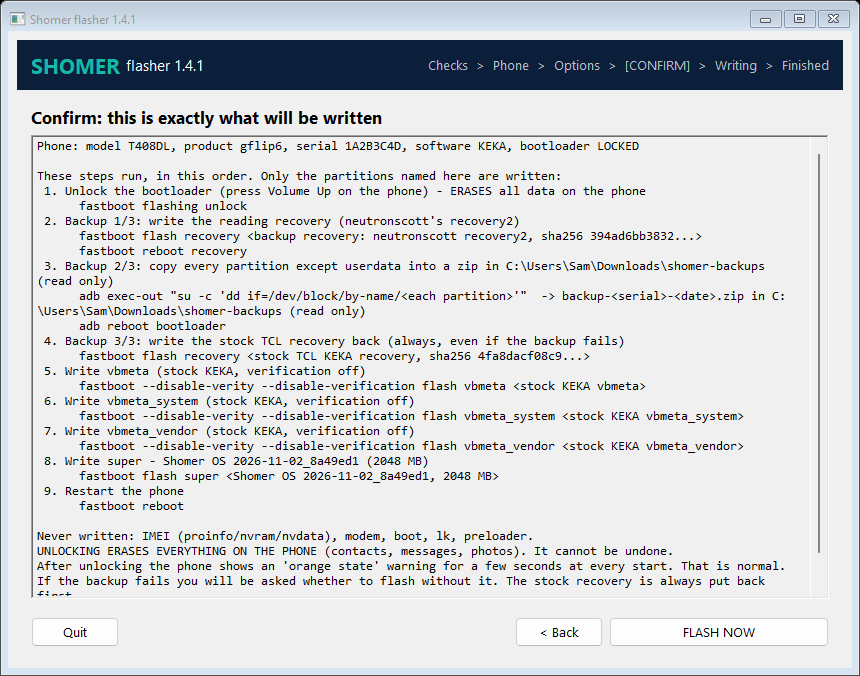
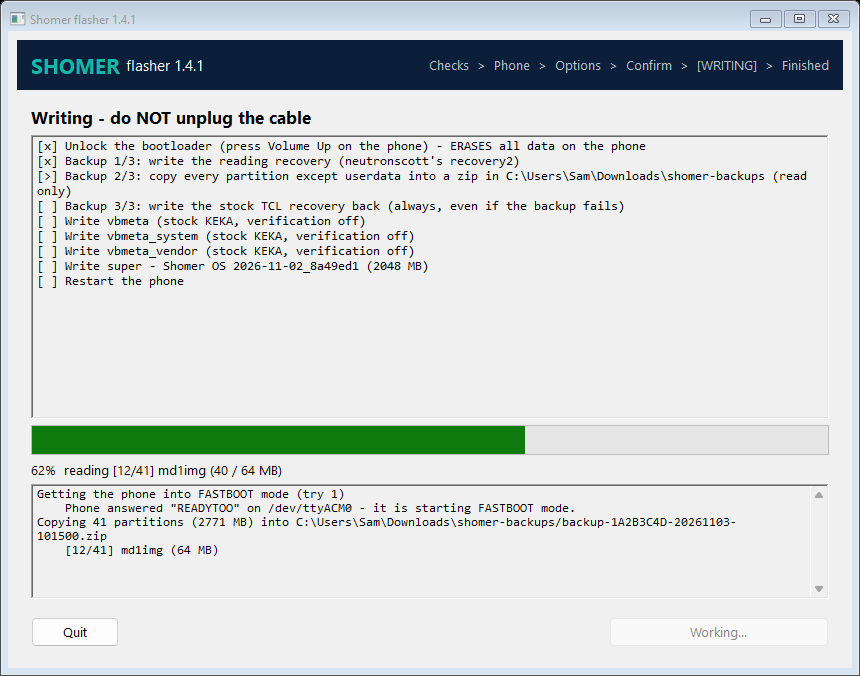

# Shomer flasher

One file that puts **Shomer OS** on a **TCL Flip 2**. It checks the phone, unlocks the bootloader if needed (with a clear warning, because unlocking erases the phone), and writes the Shomer ROM. The ROM, `fastboot` and `adb` are all inside the one file. Since **version 1.4.0** it first copies every partition of the phone into a backup zip on your computer (see [Backup first](#backup-first-on-by-default)). Since **1.4.1** it has a full-screen text interface on Linux ([TUI](#the-linux-screen-tui)) and a window on Windows ([GUI](#the-windows-window-gui)), and a failed backup no longer blocks flashing: you are asked. **1.4.2** fixes the Windows window losing the software version you type (it reached the flasher as an empty answer `""`); use 1.4.2 or newer on Windows.

| Your computer | Download from the [Releases page](../../releases/latest) |
|---|---|
| Windows 10 / 11 (64-bit) | `shomer-flasher-windows-x64.exe` |
| Linux (64-bit PC, x86_64) | `shomer-flasher-linux-x86_64` |

Each file is about 790 MB because the whole ROM (and the two recovery images for the backup) is inside. Check the download against `SHA256SUMS` on the same Release page (the flasher also checks itself before it does anything).

> **Status: not yet tested on a real phone.** Every step has been tested against a simulated phone (mock fastboot, mock adb and a mock preloader), and the Windows `.exe` has been run on Windows in CI, but no TCL phone has been flashed with this tool yet. Flash one test phone first.

---

## Which phones

| Phone | Software version (Settings > About phone) | Supported |
|---|---|---|
| TCL Flip 2 **T408DL** (Tracfone / Straight Talk / Total) | **KEKA** | Yes |
| TCL **4058G** sold as "unlocked", that is really a T408DL | **UPCI** | Yes (same phone, same software) |
| T408DL on an older version (KEE7, KEEZ, KEFH, KEFS) | | **No** - first install TCL's own updates (Settings > System update) until it shows KEKA, then flash |
| Other 4058G (UPBO, UPE6, UPEJ), 4058W, 4058L, Flip Go | | **No** - needs a separate build with that phone's own vendor part; this ROM would leave it without cell service |

The flasher enforces this: it reads the model and software version over USB when it can, otherwise it asks you to type the 4 letters you see (`KEKA` or `UPCI`; capital or small letters, spaces, the whole build number, or the same keys with the Hebrew keyboard layout on are all fine; 3 tries); and in fastboot mode it checks that the phone reports product `gflip6`. **It never blocks on the model or version (1.4.3):** when it cannot detect them, or what it detects is not a KEKA/UPCI TCL Flip 2, it shows a WARNING with what it found, lets you choose `KEKA` or `UPCI` yourself and asks "Flash anyway as ...?" (default No). `--variant KEKA` (or `UPCI`) answers the version question in advance (useful when adb cannot read the phone); `--force-variant` also answers the "Flash anyway?" question yes (the warning is still shown and logged). The other safety stops (checksums, incomplete backup, two phones, disk space, lost connection, locked bootloader) are not affected.

## What it writes, and what it never touches

It writes exactly four partitions:

- `super` - the Shomer OS ROM (system, vendor, product). vendor and product are TCL's stock KEKA parts, byte for byte; system is Shomer.
- `vbmeta`, `vbmeta_system`, `vbmeta_vendor` - TCL's **stock KEKA** files, written with `--disable-verity --disable-verification`. This is required: Shomer changes the system part, and with verification on the phone would refuse to start it. This is the same step every TCL Flip 2 custom ROM guide uses. The exact list, order and flags come from the image build's `flash-plan.json` (bundled inside the flasher); the flasher cannot be built if it would write anything else.

It **never** writes the IMEI (`proinfo`), `nvram`, `nvdata`, the modem (`md1img`, `md1dsp`), `boot`, `lk` (bootloader), the preloader, or anything else. This is enforced in the code (`internal/flasher/flow.go`, `AllowedPartitions`) and tested.

The one exception is the **backup** (on by default, see below): it writes the `recovery` partition twice - first a reading recovery, then the genuine stock TCL recovery back. Only two exact images can ever go there; both are pinned by SHA-256 in the code (`internal/flasher/backup.go`) and listed in the `backup_first` section of the image build's `flash-plan.json` (recovery2 `394ad6bb...`, then stock `4fa8dacf...`); the flasher cannot be built if the plan lacks that section or names other bytes. With `--no-backup`, recovery is never touched.

## Backup first (on by default)

Before it writes the ROM, the flasher copies **every partition of the phone** into one zip file on your computer, checks it, and only then flashes.

- **Where:** a folder `shomer-backups` next to the flasher (or `--backup-dir <folder>`). File name: `backup-<phone serial>-<date>-<time>.zip`.
- **Optional:** on by default; switch it off with the toggle on the Options screen or `--no-backup` (recovery is then never touched).
- **Space:** about 3 GB free (8 GB with `--backup-userdata`). The flasher checks first; if there is not enough room, that counts as a failed backup (below).
- **Time:** about 5-15 minutes extra.
- **What is inside:** one `<partition>.img` per partition (raw copy: super, boot, lk, logo, vbmeta..., and the phone's own IMEI/radio partitions proinfo, nvram, nvdata, nvcfg, persist), `SHA256SUMS`, `backup-info.json` and a `README.txt`. **Keep the zip private and keep it with that phone:** it holds the phone's IMEI and radio calibration, which belong to that phone only.
- **Checked twice:** each partition is checksummed on the phone and on the computer while it is copied (a bad copy is read again once), then the whole zip is read back against `SHA256SUMS`.
- **If the backup fails, it does not block you.** Whatever went wrong (not enough space, the phone did not start the reading recovery, no root, an important partition - IMEI/radio, bootloader, boot, vbmeta, super - could not be copied and checked), the flasher:
  1. **always puts the stock TCL recovery back first** (if even that fails, it stops and flashes nothing - run it again or with `--restore-recovery`),
  2. shows what failed, and
  3. asks **"Backup failed: continue flashing WITHOUT a backup? [y/N]"** (a Yes/No dialog in the window and the TUI; the default is No = stop, nothing flashed). For unattended runs, `--continue-without-backup` answers yes by itself.
- **A partial backup** (some partitions copied, an important one missing) is kept as `backup-<serial>-<date>-INCOMPLETE.zip`, with `"complete": false` and the missing partitions named in `backup-info.json` and at the top of its `README.txt`. A zip that could not even be written (disk full) is deleted. A complete backup never has `INCOMPLETE` in its name.

**Your data (contacts, messages, photos) - read this:**

- On a phone whose bootloader is still **locked** (every phone from a shop), the flasher has to unlock it first, and **unlocking erases the phone's data**. There is no way around this on this phone: nothing can read it before the unlock. So the backup of a locked phone holds the **firmware** (all the system partitions and the IMEI/radio partitions), **not your data**. Copy contacts, photos etc. off the phone yourself before you start.
- On a phone that is **already unlocked** (for example one that already runs another kosher ROM), `--backup-userdata` adds the data partition too (~4.6 GB). It is encrypted by the phone: it can only ever go back onto that same phone (with its `metadata` partition), and even then it is not guaranteed.

**How it works (and why recovery is written):**

1. `fastboot boot` (start an image without writing it) does not work on this phone's bootloader - it refuses when locked and fails when unlocked ([jackharvest, trap 5](https://github.com/jackharvest/tcl-flip-macos-unlock/blob/main/docs/traps.md)). So a reading recovery has to be **written** to the recovery partition: neutronscott's `recovery2.img` (stock TCL recovery + `su` + `busybox`).
2. `fastboot reboot recovery`, then over USB every partition is **read** (`dd`), never written.
3. Back to fastboot (by itself, or with the same unplug/plug catch as before), and the **genuine stock TCL KEKA recovery** is written back. This matters: the reading recovery is a root shell for anyone with a USB cable, so it must never stay on a Shomer phone. If anything goes wrong during the backup, the flasher still puts the stock recovery back before it stops. If that ever fails (cable pulled), run `shomer-flasher --restore-recovery`: it writes only the stock recovery.
4. Then the normal flash continues.

The phone's own previous recovery cannot be saved (it is overwritten in step 1, before anything can be read), so the `recovery.img` in the zip is the reading recovery; the stock recovery written back is TCL's own for KEKA - the same file a stock KEKA phone rebuilds for itself at every start (`/vendor/bin/install-recovery.sh`: stock boot + `/vendor/recovery-from-boot.p`, SHA-1 `40e9d0d4...`). The build makes it with `tools/make-stock-recovery.py` and refuses any other result.

**Safety checks (1.4.3):**
- The backup is only *complete* if every must-have partition is in it, checked by name: the IMEI and radio partitions `proinfo`, `nvram`, `nvdata`, `nvcfg`, plus `persist`, `protect1/2`, `seccfg`, `md1img`, `lk`, `boot`, `logo`, the three `vbmeta`, `super` and the eMMC boot area (preloader, saved as `mmcblk0boot0.img`). A partition the phone does not list counts as missing. With "include phone data", `userdata` and `metadata` are must-haves too. Anything missing: the zip is named `-INCOMPLETE.zip` and you are asked before flashing.
- If you asked to include the phone data and it is not in a backup file, the phone data is **never erased without your explicit yes** at that moment (not even with `--continue-without-backup` or the confirm screen's "erase" option).
- Variant check: `fastboot getvar product` must be exactly `gflip6` (not just start with it), nothing in `fastboot getvar all` may name another variant, and while the backup copies `super` the phone's own build fingerprints are read out of it: a phone whose own files say another variant (for example 4058W `LF91`, regular 4058G `UPEJ`, older T408DL builds), or whose version was only typed and cannot be confirmed from its files, gets a WARNING and the question "Flash anyway as ...?" (default No) before Shomer is written. Every model/variant/version check works this way: warn, your own choice, an explicit yes; never a hard refusal.
- Only one copy of the flasher runs at a time; a second copy says so and stops.
- The start-up disk check adds up the ROM and the backup when both are on the same disk.
- fastboot/adb are Android platform-tools 37.0.1, pinned by SHA-256 in the release build (`--info` shows the version).

**Not neutron.img:** neutronscott also publishes `neutron.img`. That is a **boot** image with Magisk (root), not a recovery, and it only fits the exact software it was built from - on a phone with different software it hangs on the TCL logo ([flip2 issue #16](https://github.com/neutronscott/flip2/issues/16)). Shomer does not need it and the flasher never writes `boot`.

---

## Before you start (5 minutes)

1. **Back up anything on the phone you want to keep.** Unlocking erases contacts, messages, photos, recordings - everything. (The flasher's own backup saves the phone's firmware and IMEI partitions, but on a locked phone it cannot save your data - see "Backup first".) (If the phone was already unlocked, the flasher will still recommend erasing.)
2. **Write down the phone's IMEI** - dial `*#06#`, or look at the sticker under the battery or on the box. You need it for the portal.
3. **Add the IMEI in the Shomer admin portal** and give the phone its level. Do this before the first start so the phone gets the right level straight away.
4. **Charge the phone** to at least 50 %.
5. **Use a USB data cable** (some cheap cables only charge), plugged **straight into the computer** - no hub, no front-panel port if you can avoid it.
6. **Turn on OEM unlocking** (needed on some phones before the bootloader agrees to unlock; it does no harm to do it on every phone):
   - Settings > About phone > press **Build number** 7 times until it says "You are now a developer".
   - Settings > System > **Developer options** > **OEM unlocking** = on, confirm.
7. Optional but nice: **turn on USB debugging** so the flasher can read the phone's model and software version by itself: dial `*#*#33284#*#*` (that is `*#*#DEBUG#*#*`), or Developer options > USB debugging. If the phone asks "Allow USB debugging?", choose **Allow**. Without it you just type the software version when asked.

---

## Windows - step by step

### Step 1: install the MediaTek USB driver (once per computer)

Windows needs a driver to see the phone in the two special modes the flasher uses: the short **preloader** moment when the phone powers up, and **fastboot** mode.

- Install **MediaTek drivers**: the community package used by every TCL Flip 2 guide is `mtkdrivers.exe` from neutronscott: <https://scottn.us/downloads/mtkdrivers.exe> (linked from <https://github.com/neutronscott/flip2/wiki>). Run it, allow it, reboot the computer.
- How to tell it works: open Device Manager, plug in the **turned-off** phone, and watch "Ports (COM & LPT)": a "MediaTek PreLoader USB VCOM" (or "USB Serial Device") appears for 2-3 seconds and disappears. That is exactly what the flasher catches.
- When the phone is in fastboot mode, Device Manager should show it under "Android Device" / "Android Bootloader Interface". If it shows as an unknown device with a yellow mark instead, right-click > Update driver > Browse > Let me pick > "Android Device" > "Android Bootloader Interface". (If that entry is missing, install Google's USB driver: <https://developer.android.com/studio/run/win-usb>, then try again.)

### Step 2: run the flasher

1. Put `shomer-flasher-windows-x64.exe` in a folder on a disk with **at least 3 GB free** (for example `Downloads`), plus about 3 GB for the backup. The flasher unpacks the ROM there (2.1 GB) while it works and deletes it at the end. It also writes a log file `shomer-flasher-<date>.log` next to itself.
2. Double-click it. If Windows SmartScreen says "Windows protected your PC", click **More info** > **Run anyway** (the program is not code-signed).
3. **A window opens** (see [The Windows window](#the-windows-window-gui)). It checks the ROM inside itself and unpacks it (1-3 minutes), then guides you screen by screen. Every question about the phone ("unplug it", "is it off?") comes as a dialog with the instructions in it.
4. Prefer the old console? Open `cmd` in that folder and run `shomer-flasher-windows-x64.exe --cli`.

## Linux - step by step

1. Download `shomer-flasher-linux-x86_64` and make it executable:
   ```
   chmod +x shomer-flasher-linux-x86_64
   ```
2. The easiest way is to run it with `sudo` (USB and serial-port access need it):
   ```
   sudo ./shomer-flasher-linux-x86_64
   ```
3. **ModemManager** (installed on Ubuntu, Fedora and others) grabs new USB serial ports and can steal the phone's 2-second preloader window. Stop it while flashing:
   ```
   sudo systemctl stop ModemManager      # and afterwards: sudo systemctl start ModemManager
   ```
4. Without sudo, set up access once instead:
   ```
   echo 'SUBSYSTEM=="usb", ATTR{idVendor}=="0e8d", MODE="0666"' | sudo tee /etc/udev/rules.d/51-shomer-flip.rules
   echo 'SUBSYSTEM=="usb", ATTR{idVendor}=="18d1", MODE="0666"' | sudo tee -a /etc/udev/rules.d/51-shomer-flip.rules
   echo 'ATTRS{idVendor}=="0e8d", ENV{ID_MM_DEVICE_IGNORE}="1"' | sudo tee -a /etc/udev/rules.d/51-shomer-flip.rules
   sudo udevadm control --reload-rules && sudo udevadm trigger
   sudo usermod -aG dialout $USER        # then log out and in again
   ```
5. You need about 3 GB free in the folder where the file is (or pass `--workdir /some/other/folder`), plus about 3 GB for the backup. No drivers are needed on Linux.
6. Started in a terminal with no options (or only `--backup-dir`, `--workdir`, `--no-backup`, `--backup-userdata`, `--port`, `--keep`), it opens a **full-screen text interface** (see [The Linux screen](#the-linux-screen-tui)). Nothing else to install. For the plain line-by-line console, add `--cli`.

---

## The Linux screen (TUI)

Six screens, always in this order: **Checks > Phone > Options > Confirm > Writing > Finished**. Keys: **Up/Down** move, **Enter** chooses / continues, **Left/Right** pick Yes or No, **y**/**n** answer a question, **Esc** goes back, **q** quits (while writing it asks first, because quitting then can leave the phone half done - which running the program again fixes). The screens below are rendered by the TUI itself with example data (`CAPTURE_DIR=docs go test ./internal/tui -run Demo`); the end-to-end test drives the real program through the same screens.

1. **Checks** - permission to use USB (root/sudo or the udev rule), ModemManager, free disk for the ROM and for the backup, and the ROM inside the program (checksums, then unpacking). A warning tells you the exact command to fix it; only a real blocker (not enough disk for the ROM, a damaged download) stops you.
2. **Phone** - the program tells you when to unplug, power off and plug in (each step in a box; Enter when done). Then: model, product, serial, software version and whether the bootloader is LOCKED or UNLOCKED.
3. **Options** - *Backup the phone first* (ON by default), *Backup folder* (Enter to edit), *Include phone data* (only possible on an already unlocked phone), *Erase phone data after flashing* (only offered when the phone is already unlocked; unlocking erases it anyway).
4. **Confirm** - every step and the exact command it sends, in order, with what is never written. **FLASH NOW** asks one last Yes/No (default No). This replaces typing `UNLOCK` and `FLASH` in the console.
5. **Writing** - one line per step (`[x]` done, `[>]` running, `[!]` failed, `[-]` skipped), a progress bar (for the backup: partition by partition) and the last lines of the log. Questions from the phone side (unplug/plug again, "Backup failed: continue...?") pop up in a box.
6. **Finished** - done or why it stopped, the backup zip (or the INCOMPLETE one), what happens next and the log file. When you close it, the same lines stay in the terminal.

```
 SHOMER flasher 1.4.2                       Checks > Phone > Options > Confirm > Writing > Finished
 Checks before we start

 [ OK ] Permission to use USB  running as root (sudo)
 [WARN] ModemManager  running - it can grab the phone's port while we try to catch it
        In another terminal:  sudo systemctl stop ModemManager   (start it again after flashing)
 [ OK ] Free disk for the ROM  41230 MB free in /home/sam/shomer-flasher-work (needs 2248 MB)
 [ OK ] Free disk for the backup  41230 MB free in /home/sam/shomer-backups (needs about 2900 MB)
 [ OK ] ROM inside this program  every file matches its SHA-256

 Next: the program helps you get the phone into fastboot mode. Nothing is written until you
confirm.


  [ Continue: find the phone ]
────────────────────────────────────────────────────────────────────────────────────────────────────
 Enter continue  q quit
```

```
 SHOMER flasher 1.4.2                       Checks > Phone > Options > Confirm > Writing > Finished
 Writing - do NOT unplug the cable

 [x] Unlock the bootloader (press Volume Up on the phone) - ERASES all data on the phone
 [x] Backup 1/3: write the reading recovery (neutronscott's recovery2)
 [>] Backup 2/3: copy every partition except userdata into a zip in /home/sam/shomer-backups (rea…
 [ ] Backup 3/3: write the stock TCL recovery back (always, even if the backup fails)
 [ ] Write vbmeta (stock KEKA, verification off)
 [ ] Write vbmeta_system (stock KEKA, verification off)
 [ ] Write vbmeta_vendor (stock KEKA, verification off)
 [ ] Write super - Shomer OS 2026-11-05_785693c (2048 MB)
 [ ] Restart the phone


 ███████████████████████████████░░░░░░░░░░░░░░░░░░░  62%  reading [12/41] md1img (40 / 64 MB)
····································································································
 Getting the phone into FASTBOOT mode (try 1)
     Phone answered "READYTOO" on /dev/ttyACM0 - it is starting FASTBOOT mode.
 Copying 41 partitions (2771 MB) into /home/sam/shomer-backups/backup-1A2B3C4D-20261103-101500.zip
     [12/41] md1img (64 MB)
────────────────────────────────────────────────────────────────────────────────────────────────────
 working...  q quit
```

```
 SHOMER flasher 1.4.2                       Checks > Phone > Options > Confirm > Writing > Finished
 Writing - do NOT unplug the cable

 [x] Unlock the bootloader (press Volume Up on the phone) - ERASES all data on the phone
 [x] Backup 1/3: write the reading recovery (neutronscott's recovery2)
 [!] Backup 2/3: copy every partition except userdata into a zip in /home/sam/shomer-backups (rea…
 [x] Backup 3/3: write the stock TCL recovery back (always, even if the backup fails)
 [ ] Write vbmeta (stock KEKA, verification off)
 [ ] Write vbmeta_system (stock KEKA, verification off)
 [ ] Write vbmeta_vendor (stock KEKA, verification off)
 [ ] Write super - Shomer OS 2026-11-05_785693c (2048 MB)
 [ ] Restart the phone


┏━━━━━━━━━━━━━━━━━━━━━━━━━━━━━━━━━━━━━━━━━━━━━━━━━━━━━━━━━━━━━━━━━━━━━━━━━━━━━━━━━━━━━━━━━━━━━━━━┓
┃ Backup failed                                                                                  ┃
┃ BACKUP FAILED: these partitions could not be copied and checked: nvram. The backup is          ┃
┃ INCOMPLETE                                                                                     ┃
┃ The stock TCL recovery is back on the phone. Nothing else was written yet.                     ┃
┃                                                                                                ┃
┃ Backup failed: continue flashing WITHOUT a backup?                                             ┃
┃                                                                                                ┃
┃    Yes      [ No ]                                                                             ┃
┗━━━━━━━━━━━━━━━━━━━━━━━━━━━━━━━━━━━━━━━━━━━━━━━━━━━━━━━━━━━━━━━━━━━━━━━━━━━━━━━━━━━━━━━━━━━━━━━━┛
────────────────────────────────────────────────────────────────────────────────────────────────────
 Left/Right choose  Enter OK  y yes  n no  q quit
```

All screens: [docs/tui-1-checks.txt](docs/tui-1-checks.txt), [2-phone](docs/tui-2-phone.txt), [3-options](docs/tui-3-options.txt), [4-confirm](docs/tui-4-confirm.txt), [5-progress](docs/tui-5-progress.txt), [6-backup-failed](docs/tui-6-backup-failed.txt), [7-done](docs/tui-7-done.txt).

## The Windows window (GUI)

The same six screens, in a normal window (navy/teal Shomer header, the step you are on highlighted): a **Continue** button at the bottom right (its label says what comes next), **< Back** on Options and Confirm, **Quit** at the bottom left. Options are tick boxes plus the backup folder with a **Browse...** button. The Writing screen has the step list, a progress bar and the live log. Every question is a Windows dialog: OK/Cancel for "do this with the phone, then OK", Yes/No for "Backup failed: continue flashing WITHOUT a backup?" and for the last confirmation (No is the default; Cancel stops). The console window that Windows opens with the program is hidden when you double-click it; started from `cmd` with `--cli` (or `--dry-run`, `--info`, `--no-pause`) you get the plain console as before.

Screenshots, rendered by CI on a Windows runner from the real window with example data (`--gui-smoke`; every build repeats this and keeps the pictures as the `gui-screenshots` artifact):





More: [checks](docs/gui-1-checks.png), [phone](docs/gui-2-phone.png), [options](docs/gui-3-options.png), [finished](docs/gui-7-done.png).

## The plain console (`--cli`)


| Step | On the computer | On the phone | Time |
|---|---|---|---|
| 1 | "Checking the ROM inside this program" + "Unpacking" with percentages | nothing yet | 1-3 min |
| 2 | "Looking for the phone". With USB debugging on it shows the model and software and turns the phone off by itself. Otherwise it asks you to type `KEKA` or `UPCI`. | | |
| 3 | "Getting the phone into FASTBOOT mode": **unplug** the cable, make sure the phone is **completely off** (hold the red key, or take the battery out and put it back), press Enter, then **plug the cable in** | the phone starts to power up, then stops on a dark screen with small text **`=> FASTBOOT mode...`** | a few seconds |
| 4 | "Phone reports product gflip6", "Bootloader is LOCKED/UNLOCKED" | | |
| 5 (only if locked) | a big warning that unlocking **erases everything**; type `UNLOCK` (in the TUI/window: confirmed on the Confirm screen) | a question about unlocking the bootloader: press **Volume UP** = yes (Volume Down = no) | 10 s |
| 5b (backup, on by default) | what the backup does and where the zip goes; Enter = start (`n` = flash without one). If it fails: what failed, then "continue flashing WITHOUT a backup? [y/N]". Otherwise "Copying N partitions" with progress, "backup saved and checked", "Putting the stock TCL recovery back". If the phone does not come back to fastboot by itself you do the unplug/plug catch once more. | restarts into recovery (may sit on the warning / TCL logo, or show a recovery screen) while it is read | 5-15 min |
| 6 (only if it was already unlocked) | "Erase all data?" - Enter = yes (recommended) | | |
| 7 | the list of exactly what will be written; type `FLASH` | | |
| 8 | "Writing vbmeta..." x3, then "Writing super" with fastboot's progress ("Sending sparse 'super' 1/17 ..."). A line "Invalid sparse file format at header magic" is normal. | | 5-15 min |
| 9 | "Restarting the phone", then "DONE" | warning screen about the unlocked bootloader ("orange state") for a few seconds, then the TCL logo, then Shomer | first start up to 10 min |

**Why the unplug/plug dance?** On this phone `adb reboot bootloader` does not work. The only way into fastboot mode is a 2-3 second window while the phone powers up: its preloader shows a USB serial port, and if it receives the word `FASTBOOT` in time it answers `READYTOO` and stops in fastboot mode. The flasher watches for that port and sends the word itself - the same trick as neutronscott's `autobooter` (Windows) and `mtk-bootseq.py` (Linux).

### After it finishes

- The **orange-state warning** at every start is normal for an unlocked phone and cannot be removed. Do not try to re-lock the bootloader: a locked bootloader refuses a modified ROM and the phone would not start.
- The **first start is slow** (up to 5-10 minutes). Do not pull the battery during the first start.
- Make sure the **IMEI is in the portal** (see "Before you start") and the phone has internet (SIM data or Wi-Fi), so it picks up its level. Until then it runs in the safe default level. Emergency calls always work.

---

## If something goes wrong

**"I did not catch the phone"** (step 3 times out)
- The phone must be **completely off** before you plug in. Taking the battery out for 5 seconds is the surest way.
- Windows: the MediaTek driver is missing (Step 1). Watch Device Manager while plugging in.
- Linux: run with `sudo`, and stop ModemManager.
- Try another cable and another USB port (USB 2.0 ports at the back of a desktop are the most reliable).
- Answer "y" to "Try again?" - it often works on the second or third try.

**The phone answered but no fastboot device showed up**
- Windows: fastboot driver - see Step 1, "Android Bootloader Interface".
- Linux: permissions - run with `sudo`.

**"the bootloader refused to unlock"** - turn on OEM unlocking (Before you start, item 6) and run again. If you pressed Volume Down or nothing, run again and press **Volume UP**.

**"BACKUP FAILED"** - read the line under it (what failed). The stock recovery is already back on the phone. Answer **No** (the default) to stop with nothing flashed, fix the cause (free disk space, another cable, run with `sudo`) and run again; or **Yes** to flash without a backup. A partial copy is kept as `...-INCOMPLETE.zip`.

**"COULD NOT PUT THE STOCK RECOVERY BACK"** - nothing else was written. Run the program again (it puts it back before anything else) or with `--restore-recovery`. Until then do not give the phone to anyone: the reading recovery is a root shell over USB.

**Writing failed half way** - nothing is lost for good. The bootloader and recovery were not touched, so you can always get back into fastboot mode the same way. Run the flasher again.

**Stuck on the TCL logo for more than 15 minutes, or keeps restarting (bootloop)**
1. First, factory reset from recovery: turn the phone off, then hold **Volume Up + the red End (power) key** until the logo appears, then let go (TCL support FAQ: <https://www.tcl.com/global/en/support-mobile/faq/6508>); in the menu choose "Wipe data/factory reset" (Volume keys move, Power selects), then "Reboot system now".
2. Still stuck: run the flasher again (it catches the phone the same way) and answer **yes** to "Erase all data?".
3. Still stuck: send the log file (`shomer-flasher-<date>.log`, next to the program) to the Shomer team.

**Going back to stock TCL software**
- You need a stock dump of the **same** software version. For a T408DL KEKA, the stock `super` and `vbmeta*` files (neutronscott's public dump) are in the private `Shomer-TCL/shomer-images` repo under `stock/KEKA/` (join the `super.gz.part-*` files, check `SHA256SUMS`, `gunzip`). Then, in fastboot mode:
  ```
  fastboot flash vbmeta vbmeta
  fastboot flash vbmeta_system vbmeta_system
  fastboot flash vbmeta_vendor vbmeta_vendor
  fastboot flash super super
  fastboot -w
  fastboot reboot
  ```
  (Get into fastboot with this flasher - it will stop safely at the "Type FLASH" question; answer anything else - or with `autobooter`/`mtk-bootseq.py`.)
- **Never** flash anyone else's `proinfo`, `nvram`, `nvdata`, `nvcfg`, `persist`, `protect1/2`, modem or preloader files - they carry another phone's IMEI and radio calibration. Flashing them is illegal in many places and can wreck the radio.

---

## Options (for technicians)

```
shomer-flasher [--dry-run] [--info] [--port COM5|/dev/ttyACM0] [--workdir DIR] [--keep] [--no-pause] [--version]
               [--no-backup] [--backup-dir DIR] [--backup-userdata] [--restore-recovery] [--continue-without-backup]
               [--cli] [--ui] [--licenses]
```

- Interface: with no options (or only the backup/workdir/port/keep options, which then pre-fill the Options screen) in a terminal, Linux opens the TUI and Windows the window. `--cli` gives the plain console. `--no-pause`, `--dry-run`, `--info`, `--restore-recovery`, or not being in a terminal (a pipe, a script) also give the console, so scripts behave exactly as in 1.4.0. `--ui` forces the TUI/window.
- `--continue-without-backup` - if the backup fails, flash anyway without asking (the stock recovery is still put back first; if that fails nothing is flashed). For unattended runs.
- `--licenses` - print the licences of the open-source Go libraries inside the program.

- `--no-backup` - flash without the backup (recovery is then never touched).
- `--backup-dir` - folder for the backup zip (default `shomer-backups` next to the program).
- `--backup-userdata` - also copy the data partition; only useful on a phone that was already unlocked (unlocking erases it).
- `--restore-recovery` - only write the stock TCL recovery back, then restart the phone. For a backup that was interrupted.

- `--dry-run` - check and unpack the ROM and print the exact commands, without touching any phone.
- `--info` - print the build, every file inside with its SHA-256, and the accepted phones.
- `--port` - use this serial port for the preloader instead of finding it (Windows COM port or Linux `/dev/ttyACM*`).
- `--workdir` - unpack the ROM into another folder (needs ~2.3 GB). The flasher always works in its own subfolder `shomer-flasher-work` inside it (marked with a `.shomer-flasher-work` file) and removes only its own files at the end; nothing else in that folder is ever deleted.
- `--keep` - keep the unpacked ROM and the extracted fastboot/adb afterwards.

Exit codes: 0 = done, 3 = stopped on purpose (wrong phone, bad checksum, you said no; nothing was written unless the message says so), 1 = error, 2 = the file itself is broken.

The exact commands it runs on a phone are:

```
fastboot getvar product            # must start with gflip6
fastboot getvar unlocked           # (oem device-info as a fallback)
fastboot flashing unlock           # only if locked, only after you type UNLOCK or confirm on screen ("oem unlock" as a fallback)
# backup (default; skipped with --no-backup):
fastboot flash recovery <recovery2.img, sha256 394ad6bb...>
fastboot reboot recovery
adb shell "su -c 'id'"             # must be root
adb shell "su -c '... blockdev --getsize64 ...'"   # list /dev/block/by-name (rpmb skipped)
adb shell "su -c 'sha256sum <partition>'"          # per partition, then:
adb exec-out "su -c 'busybox stty raw; busybox dd if=<partition> bs=1048576'"  > into the zip
adb reboot bootloader              # or the unplug/plug catch
fastboot flash recovery <stock TCL KEKA recovery, sha256 4fa8dacf...>   # always, also after a failed backup
# if the backup failed: stop, unless you answer yes / --continue-without-backup
fastboot --disable-verity --disable-verification flash vbmeta        <stock KEKA vbmeta>
fastboot --disable-verity --disable-verification flash vbmeta_system <stock KEKA vbmeta_system>
fastboot --disable-verity --disable-verification flash vbmeta_vendor <stock KEKA vbmeta_vendor>
fastboot flash super <Shomer super, 2 GiB raw; fastboot sends it in 128 MB sparse pieces>
#   if the bootloader refuses super: fastboot reboot fastboot ; fastboot flash super <same>   (fastbootd, stock recovery)
fastboot erase userdata            # only if the phone was already unlocked and you said yes
fastboot reboot
```

---

## Sources for the unlock and flash method

- neutronscott, **flip2** wiki and `autobooter.py` - fastboot only through the preloader with the `FASTBOOT` boot sequence, then `fastboot flashing unlock`: <https://github.com/neutronscott/flip2/wiki>, <https://github.com/neutronscott/flip2/blob/main/autobooter.py>
- neutronscott, `mtk-bootseq.py` (Linux): <https://gist.github.com/neutronscott/2e4179af74c2fadec101a184fbb6a89e>
- jackharvest, **tcl-flip-macos-unlock** (4058G UPCI, Aug 2026): "fastboot is only reachable through a 2-3 second preloader window (`adb reboot bootloader` does not work)", the `READY` + reversed reply, product `gflip6`, max-download-size 128 MB, unlock confirmed with Volume Up, no BROM on KEKA/UPCI hardware: <https://github.com/jackharvest/tcl-flip-macos-unlock> (`tools/bootseq.py`, `docs/device-facts.md`), and <https://jackharvest.com/index.php/2026/08/01/unlock-root-tcl-4058g-flip-phone-macos/>
- darth, "Instructions for installing a kosher ROM on TCL Flip2/Classic T408DL" (Apps4Flip forum): autobooter, `fastboot flashing unlock` + Volume Up, `fastboot flash --disable-verity --disable-verification vbmeta/vbmeta_system/vbmeta_vendor`, then `fastboot flash super super.bin` (in fastbootd); tested on T408DL, 4058E and 4058L: <https://forums.apps4flip.com/d/693-instructions-for-installing-a-kosher-rom-on-tcl-flip2classic-t408dl>
- Reports of `fastboot flash super` from the bootloader on the T408DL ("Sending sparse 'super' 1/12"): same Apps4Flip thread and the jtechforums TCL Flip 2 master thread <https://jtechforums.org/t/tcl-flip-2-phone-master-thread/601>
- UPCI 4058G = rebadged T408DL KEKA: jtechforums threads summarised in the Shomer research notes (2026-10-26).

- Backup: neutronscott flip2 wiki "Recovery Image" (`recovery2.img` with su/busybox, the `busybox stty raw; busybox dd` read, the by-name partition list) <https://github.com/neutronscott/flip2/wiki/Further-customization>; jackharvest `docs/recovery-and-dump.md` and `tools/dump-from-recovery.sh` (dumped a 4058G/UPCI this way; `fastboot boot` dead; `fastboot reboot recovery` works; without `stty raw` the images come out corrupt); `neutron.img` is a Magisk boot image (`create-boot` in the flip2 repo).

Nothing in these sources has been verified by us on hardware yet.

---

## Third-party files inside

- `recovery2.img` by **neutronscott** (Scott Nicholas), <http://scottn.us/downloads/recovery2.img> (sha256 `394ad6bb38321565b121dec8c5dff098cd238919b766f9cbc0c994f4f0a376ac`), bundled since 1.4.0 and used only to read the phone during the backup; the flasher always writes the stock recovery back afterwards. It is TCL's KEE7 stock recovery with Magisk `su` and BusyBox added. No licence is stated for the image itself (neutronscott's flip2 repository is public domain / Unlicense, but this file is not in it). Thanks to neutronscott, and to jackharvest, whose notes made the backup path clear.
- Licence notices for the free software inside `recovery2.img`:
  - **Magisk** (`su`, `magisk`) by John Wu and contributors, GNU General Public License v3.0. Source: <https://github.com/topjohnwu/Magisk>. Licence text: <https://www.gnu.org/licenses/gpl-3.0.txt>.
  - **BusyBox** by Erik Andersen, Rob Landley, Denys Vlasenko and others, GNU General Public License v2.0. Source: <https://busybox.net/downloads/>. Licence text: <https://www.gnu.org/licenses/old-licenses/gpl-2.0.txt>.
  - These binaries are passed on unmodified, exactly as in neutronscott's image; the sources are at the addresses above.
- The stock TCL KEKA recovery (rebuilt from TCL's own stock boot + `recovery-from-boot.p`) and the stock vbmeta files are TCL's.
- `fastboot` and `adb` are Google's Android SDK Platform-Tools, downloaded from Google at build time.
- The screens use permissively licensed Go libraries, compiled in: on Linux **Bubble Tea** and **Lip Gloss** (Charm, MIT) with their small helpers (MIT); on Windows **walk** and **win** (Alexander Neumann and contributors, BSD-3-Clause; pure Go Win32, no browser or OpenGL runtime). No GPL code is compiled into the program. `shomer-flasher --licenses` prints every licence text (file `cmd/shomer-flasher/THIRD_PARTY_LICENSES.txt`, made by `tools/third-party-notices.sh`).

## For developers

- `cmd/shomer-flasher` - the program. `internal/app` - the screens' shared flow and state (checks, which screen, options, the confirm list, progress rows, questions) used by both `internal/tui` (Linux, Bubble Tea) and `internal/gui` (Windows, walk); the TUI and the window only draw it, so they cannot drift. The confirm list, the console's plan and the dry run all come from one function (`flasher.PlanSteps`). `internal/flasher` - the steps (all phone logic, the partition allow-list, the preloader handshake). `internal/bundle` - the payload format (the ROM, fastboot/adb and the stock vbmeta files appended to the program, with SHA-256 for every file). `cmd/mkbundle` - packs a payload onto a built program.
- Tests: `go test ./...` (unit tests with a simulated phone: locked > unlock > flash, phone restarting after unlock, already unlocked, wrong product, wrong model, old software, wrong typed version, bad checksum, unlock refused, user says no, super falling back to fastbootd, the partition allow-list, dry run) and `python3 test/e2e.py <linux binary>` (the real built binary against `test/mock-fastboot.py`, `test/mock-adb.py` and `test/mock-preloader.py` on a pseudo-terminal, including a failed backup answered No and `--continue-without-backup`), and `python3 test/e2e_tui.py <linux binary>` (needs `pip install pyte`: the real binary's TUI in a pseudo-terminal, keys pressed like a person: locked phone with backup, and a failed backup answered Yes). `test/make-test-flasher.sh` builds a small test flasher for both. Windows: `shomer-flasher.exe --gui-smoke <folder>` opens the window, shows every screen and saves PNGs (CI). The `.syso` next to `main.go` embeds the Windows manifest (Common Controls 6, DPI aware) the window needs: `go run github.com/akavel/rsrc@v0.10.2 -manifest cmd/shomer-flasher/shomer-flasher.manifest -arch amd64 -o cmd/shomer-flasher/rsrc_windows_amd64.syso`.
- Building and releasing: see [docs/BUILDING.md](docs/BUILDING.md). The GitHub Action `build-release` fetches the image from the private `shomer-images` repo, builds both binaries, tests them (Linux end-to-end, Windows dry run on a Windows runner) and attaches them to a Release. The ROM is never stored in this git repo.

Third-party parts inside the binaries: Android SDK Platform-Tools (`fastboot`, `adb`, Google; see their NOTICE file), go.bug.st/serial (BSD-3-Clause), golang.org/x/sys and x/term (BSD-3-Clause), Bubble Tea / Lip Gloss and helpers (MIT, Linux), walk / win (BSD-3-Clause, Windows), TCL's stock KEKA vbmeta files. Full texts: `--licenses`.
